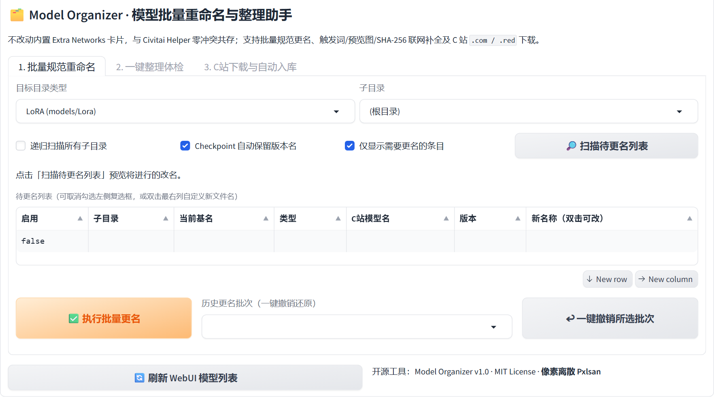
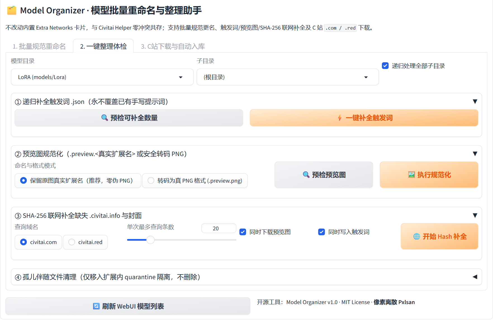
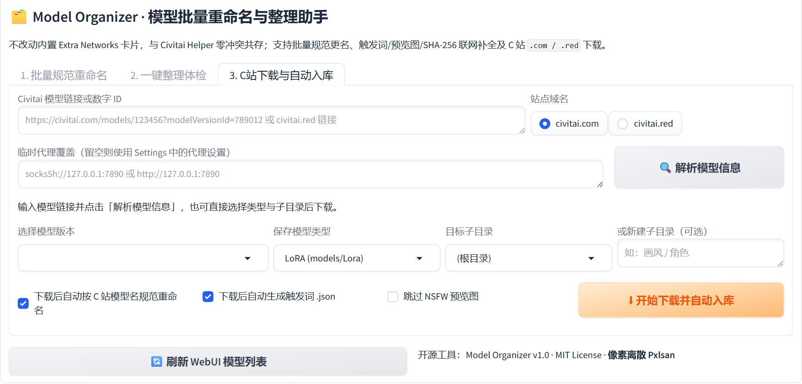

# SD WebUI Model Organizer（模型批量重命名与整理助手）

轻量、无冲突的 **Stable Diffusion WebUI / Forge / Forge Neo** 模型批量重命名、信息补全与整理扩展（核心引擎与 `organizer_cli.py` 命令行同样适用于 **ComfyUI** 用户）。

> **设计原则**：不改动 WebUI 内置 Extra Networks 卡片与 DOM，可与 **Civitai Helper** 等已有插件零冲突共存；专为「浏览器在 C 站下完模型 → 一键补齐信息、触发词、封面并规范改名」的高频流程设计。



---

## 目录

- [一、你能用它解决什么问题](#一你能用它解决什么问题)
- [二、安装与首次配置（必看）](#二安装与首次配置必看)
- [三、两条最常用的上手路线](#三两条最常用的上手路线)
- [四、三大功能页分步教程](#四三大功能页分步教程)
  - [Tab 1 · 1. 批量规范重命名](#tab-1--1-批量规范重命名)
  - [Tab 2 · 2. 一键整理体检](#tab-2--2-一键整理体检)
  - [Tab 3 · 3. C站下载与自动入库（备用）](#tab-3--3-c站下载与自动入库备用)
- [五、ComfyUI 与独立命令行（CLI）教程](#五comfyui-与独立命令行cli教程)
- [六、数据安全与本地存储说明](#六数据安全与本地存储说明)
- [七、常见问题 FAQ](#七常见问题-faq)
- [八、开源协议](#八开源协议)

---

## 一、你能用它解决什么问题

- **文件名乱成一团**：刚下的模型叫 `v15_final_fp16.safetensors` 或 `20250401_style.safetensors`，在面板里根本分不清是谁 → **按 `.civitai.info` 一键改为 C 站规范模型名**，模型本体、封面图、触发词 `.json`、第三方伴随文件等 **22 种后缀同步更名**。
- **浏览器只下了一个 `.safetensors`**：没下 `.civitai.info` 和封面图，懒得回去翻网页贴链接 → **纯靠文件内容 SHA-256 指纹反查 C 站**，自动认出模型名并补全 `.civitai.info`、封面和触发词。
- **选了 LoRA 却不知道触发词**：很多老模型没有原生 `.json` 或缺少 `activation text` → **递归从 `.civitai.info` 抽取 `trainedWords` 写入 `.json`**，同时绝不覆盖你手写修改过的提示词。
- **封面图不显示或“伪 PNG”**：网页保存的图片其实是 `.webp` / `.jpg` 或缺 `.preview` 中缀 → **规范为 `.preview.<真实扩展名>` 或调用 Pillow 无损转码为真 PNG**。
- **删了模型剩下一堆残余垃圾**：手动删除 `.safetensors` 后留下孤立 `.info` / `.json` / `.preview.png` → **只扫描、仅移入扩展内隔离区，绝不直接永久删除**。

---

## 二、安装与首次配置（必看）

### 1. 安装插件

任选一种方式安装：

- **方式 A（推荐 · WebUI 界面安装）**：
  1. 打开 SD WebUI / Forge，进入 **`Extensions` → `Install from URL`**。
  2. 在「URL for extension's git repository」中填入：
     ```text
     https://github.com/JHH-hub/sd-webui-model-organizer.git
     ```
  3. 点击 **`Install`**，等待安装完成后切回 **`Installed`** 点 `Apply and restart UI`，或**彻底关闭控制台后重新启动 WebUI**。

- **方式 B（手动克隆）**：
  ```bash
  cd extensions
  git clone https://github.com/JHH-hub/sd-webui-model-organizer.git
  ```
  随后重启 WebUI，在顶部标签栏找到 **「模型整理助手」**。

### 2. 首次配置（如果你只需要纯离线改名/整理，可跳过本步）

进入顶部 **`Settings` → `Model Organizer`**，按需填写后点击页面顶部 **`Apply settings`**：

| 设置项 | 默认值 | 说明 |
| --- | --- | --- |
| **Civitai 域名切换** | `civitai.com` | 可切换 `civitai.com` / `civitai.red`（不影响原 Civitai Helper 配置） |
| **Civitai API Key** | 空 | 仅下载需登录访问/受限模型时必填；普通 Hash 识别通常可留空 |
| **HTTP / SOCKS5 代理地址** | 空 | 国内联网查 Hash 或下载必填，例如 `http://127.0.0.1:7890` 或 `socks5h://127.0.0.1:7890` |
| **下载或补全预览图时跳过 NSFW 标记图片** | 关闭 | 开启后联网拉封面会跳过带 NSFW 标记的预览图 |
| **C站下载完成后自动按规范名重命名** | 开启 | 仅影响 Tab 3 下载入库流程 |
| **C站下载完成后自动写入触发词 `.json`** | 开启 | 仅影响 Tab 3 下载入库流程 |

---

## 三、两条最常用的上手路线

### 路线 A：浏览器在 C 站刚下了一批裸 `.safetensors`（只有权重文件，没有链接/封面/信息）

1. 先按上文在 **`Settings → Model Organizer`** 配好代理和偏好域名，点 **`Apply settings`**。
2. 切到 **`模型整理助手` → `2. 一键整理体检`**，选择模型目录（如 `LoRA (models/Lora)`），按需勾选 `递归处理全部子目录`。
3. 展开 **`③ SHA-256 联网补全缺失 .civitai.info 与封面`** → 点击 **`🌐 开始 Hash 补全`**。
   - 插件会自动计算 `.safetensors` 文件指纹去 C 站反查（**不需要你手动粘贴链接**），命中后自动写入 `.civitai.info`、下载封面图 `.preview.*` 并同步写入触发词 `.json`。
4. 切回 **`1. 批量规范重命名`** → 点 **`🔎 扫描待更名列表`** → 确认无误点 **`✅ 执行批量更名`** → 最后点底部 **`🔄 刷新 WebUI 模型列表`**。

### 路线 B：存量模型库整理（已有 `.civitai.info`，想统一名称、补齐触发词和预览图）

全程**纯离线**即可完成，无需代理：

1. 打开 **`1. 批量规范重命名`** → 选好目录和子目录 → 点 **`🔎 扫描待更名列表`** → 按需调整或取消个别条目后点击 **`✅ 执行批量更名`**。
2. 切到 **`2. 一键整理体检`**：
   - 点 **`① 递归补全触发词 .json`** 的 **`🔍 预检可补全数量`**，确认后点 **`⚡ 一键补全触发词`**；
   - 点 **`② 预览图规范化`** 的 **`🔍 预检预览图`**，确认后点 **`🖼️ 执行规范化`**；
   - 展开 **`④ 孤儿伴随文件清理`** 点 **`🔍 仅扫描孤儿文件`**，核对列表后按需 **`📦 安全移入隔离目录`**。
3. 点击左下角 **`🔄 刷新 WebUI 模型列表`** 让面板生效。

---

## 四、三大功能页分步教程

### Tab 1 · `1. 批量规范重命名`


1. **选择目标范围**：
   - **`目标目录类型`**：支持 `LoRA (models/Lora)`、`Checkpoint 大模型 (models/Stable-diffusion)`、`Embedding / TI (embeddings)`、`LyCORIS (models/LyCORIS)` 以及 **`自定义目录（可填入 ComfyUI 等任意路径）`**。
   - **`子目录`**：自动列出当前模型目录下的全部子文件夹；若只想处理根目录选 `(根目录)`，想一次扫完整个库可勾选 **`递归扫描所有子目录`**。
   - **`Checkpoint 自动保留版本名`**（默认开启）：大模型会保留 `Model - Version` 区分不同版本（如 `NoobAI-XL - v1.0`），避免 `v1.0` 和 `v1.1` 撞名；LoRA 默认采用简洁的 C 站模型名。
   - **`仅显示需要更名的条目`**（默认开启）：跳过当前文件名已经规范的模型，列表更清爽。
2. **扫描与微调**：
   - 点击 **`🔎 扫描待更名列表`**（只读操作，不会修改任何文件）。
   - 在预览表格里：
     - 不想改某一行：取消勾选最左侧 **`启用`** 复选框；
     - 想自定义某个名字：双击最右侧 **`新名称（双击可改）`** 单元格直接修改；
     - 同目录下若存在同一 LoRA 的多个不同版本，插件会自动为你拼接版本名（`模型名 - 版本名`）防止同名冲突。
3. **执行与历史撤销兜底**：
   - 确认表格无误后，点击 **`✅ 执行批量更名`**。
   - **完整 22 种联动伴随文件后缀**：重命名时会以同目录同基名为组，原子化同步更名：
     - 模型本体：`.safetensors`、`.ckpt`、`.pt`、`.pth`
     - 元数据与触发词：`.civitai.info`、`.info`、`.json`、`.yaml`、`.txt`
     - 预览图：`.preview.png`、`.preview.jpg`、`.preview.jpeg`、`.preview.webp`、`.png`、`.jpg`、`.jpeg`、`.webp`
     - 第三方伴随文件：`.safetensors.weilin-info.json`、`.ckpt.weilin-info.json`、`.pt.weilin-info.json`、`.source.json`、`.来源.json`
   - 每次执行都会将前后路径映射写入扩展目录 `data/rename_history.json`。如果误操作，可在下方 **`历史更名批次`** 下拉框选回对应批次，点击 **`↩ 一键撤销所选批次`** 完整还原。

---

### Tab 2 · `2. 一键整理体检`



先在顶部选定 **`模型目录`**、**`子目录`** 与是否 **`递归处理全部子目录`**，以下 4 项均支持先「预检 / 扫描」看清范围后再实际写入：

1. **① 递归补全触发词 `.json`（永不覆盖已有手写提示词）**
   - 读取 `.civitai.info` 中的 `trainedWords`，自动剥离 `<lora:...>` 标签并去重，写入 WebUI 原生同名 `.json` 的 `activation text` 字段（连同 `baseModel` 一起建立或补齐空字段）。
   - 若对应 `.json` 已经填有非空 `activation text`（例如你手调过的常用词），插件会**直接跳过，绝不覆盖**。
   - 建议流程：先点 **`🔍 预检可补全数量`** 查看会新建/补全哪些条目，再点 **`⚡ 一键补全触发词`**。

2. **② 预览图规范化（`.preview.<真实扩展名>` 或安全转码 PNG）**
   - WebUI 默认需要 `<模型名>.preview.<ext>` 才会稳定显示预览；本功能按**精确文件基名**匹配（例如 `model_a` 只匹配 `model_a.jpg`，绝不会误匹配 `model_a_v2.png`）。
   - 提供两种模式：
     - **`保留原图真实扩展名（推荐，零伪 PNG）`**：原本是 `.jpg`/`.webp`/`.png` 就严格改为 `.preview.jpg`/`.preview.webp`/`.preview.png`，快且零失真；
     - **`转码为真 PNG 格式 (.preview.png)`**：通过 Pillow 读取像素重新编码为标准 PNG（保留透明通道）并用临时文件原子替换，拒绝简单粗暴改后缀制造“伪 PNG”。

3. **③ SHA-256 联网补全缺失 `.civitai.info` 与封面**
   - 专为**「只在 C 站下了 `.safetensors`，没有信息文件也没保存链接」**的模型设计。
   - 按 4 MB 流式分块计算 SHA-256（不把整个大模型塞进内存），自动跳过 `.vae.*` 文件；查询 Civitai `by-hash` 接口补全 `.civitai.info`，并可勾选 **`同时下载预览图`** 与 **`同时写入触发词`**。
   - `单次最多查询条数` 默认 `20`（范围 `1～100`）；C 站未收录（返回 404）的模型会记录进 `data/not_found_hashes.json`，下次运行直接跳过，节省联网时间。

4. **④ 孤儿伴随文件清理（仅移入扩展内 `quarantine` 隔离，不删除）**
   - 先点 **`🔍 仅扫描孤儿文件`** 列出同一目录下没有对应模型本体（`.safetensors/.ckpt/.pt/.bin/.pth`）的孤立 `.civitai.info` / `.json` / `.preview.*` / `.weilin-info.json` / `.source.json` 等文件。
   - 内置保护白名单，自动忽略 `config.json`、`adapter_config.json`、`model_index.json`、`tokenizer_config.json`、`rename_history.json`、`not_found_hashes.json` 等工程配置。
   - 点击 **`📦 安全移入隔离目录`** 后，文件会保留相对目录结构移动到 `extensions/sd-webui-model-organizer/data/quarantine/<时间戳>/` 下，**绝不会做永久删除**。

---

### Tab 3 · `3. C站下载与自动入库（备用）`



平时在浏览器直接点击 C 站 Download 即可；如果你需要用服务器代理直下、断点续传、或在 `civitai.com` / `civitai.red` 之间快速切换：

1. 在 **`Civitai 模型链接或数字 ID`** 粘贴完整网址（支持带 `modelVersionId`）或纯数字模型 ID，选择 `.com` 或 `.red`（可在第二行填写本次生效的临时代理覆盖），点击 **`🔍 解析模型信息`**。
2. 解析后会自动显示模型标题、推荐入库目录（`LoRA` / `Checkpoint` / `Embedding` / `LyCORIS`）与可用版本列表；确认目标 **`保存模型类型`**、**`目标子目录`**（也可在最右侧新建子目录）。
3. 勾选 **`下载后自动按 C 站模型名规范重命名`** 与 **`下载后自动生成触发词 .json`**，点击 **`⬇ 开始下载并自动入库`**：
   - 下载过程写入 `.part` 临时文件并支持 HTTP `Range` 断点续传，完成后再原子改名落盘并补齐 `.civitai.info`、预览图与触发词。

---

## 五、ComfyUI 与独立命令行（CLI）教程

如果你平时主要使用 **ComfyUI**（目录通常是 `D:\ComfyUI\models\loras` 或 `checkpoints`）：
- **可视化操作**：若本机也装了 SD WebUI / Forge，在 **`Tab 1 → 目标目录类型`** 里选择 **`自定义目录`**，直接填入你的 ComfyUI 模型路径即可扫描更名；
- **纯命令行直接跑（无需启动 WebUI）**：直接用 Python 运行插件根目录下的 `organizer_cli.py`（依赖仅 `requests` 与 `Pillow`）。

### 全部 8 个子命令速查

| 子命令 | 作用 | 关键参数 |
| --- | --- | --- |
| `scan <dir>` | 只读预览重命名建议 | `--recursive`、`--no-checkpoint-version`、`--limit 50` |
| `rename <dir>` | 按 `.civitai.info` 批量改名并记录历史 | `--recursive`、`--no-checkpoint-version`、`--dry-run` |
| `undo` | 撤销最近一次（或指定批次）改名 | `--batch-id <ID>` |
| `sync-triggers <dir>` | 从 `.civitai.info` 补全 WebUI `.json` 触发词 | `--recursive`、`--dry-run` |
| `normalize-previews <dir>` | 规范化预览图为 `.preview.<ext>` 或真 PNG | `--recursive`、`--mode keep_ext\|convert_png`、`--dry-run` |
| `scan-orphans <dir>` | 扫描孤儿伴随文件（加 `--quarantine` 才移动） | `--recursive`、`--quarantine <隔离目录>` |
| `fetch-hash <dir>` | 计算 SHA-256 联网补全 `.civitai.info`/封面/触发词 | `--domain`、`--proxy`、`--api-key`、`--limit`、`--recursive`、`--no-preview`、`--no-triggers` |
| `download <url_or_id> <dir>` | 从 C 站下载并自动改名整理 | `--domain`、`--proxy`、`--api-key`、`--version-id`、`--skip-nsfw`、`--no-rename`、`--no-triggers` |

### 常用命令示例

```bash
# 1. 为只有 .safetensors 的 ComfyUI LoRA 目录按 SHA-256 联网补全信息与封面（每次 30 个，走本地代理）
python organizer_cli.py fetch-hash "D:\ComfyUI\models\loras" --recursive --domain civitai.red --proxy "http://127.0.0.1:7890" --limit 30

# 2. 只读扫描可重命名模型
python organizer_cli.py scan "D:\ComfyUI\models\loras" --recursive

# 3. 先用 --dry-run 预演改名，再去掉 --dry-run 正式执行
python organizer_cli.py rename "D:\ComfyUI\models\loras" --recursive --dry-run
python organizer_cli.py rename "D:\ComfyUI\models\loras" --recursive

# 4. 如果后悔了，一键撤销最近一次批量改名
python organizer_cli.py undo

# 5. 触发词补全 & 预览图规范化（均建议先加 --dry-run 预检）
python organizer_cli.py sync-triggers "D:\ComfyUI\models\loras" --recursive --dry-run
python organizer_cli.py normalize-previews "D:\ComfyUI\models\loras" --recursive --mode keep_ext

# 6. 扫描孤儿文件；确认后指定隔离目录移入（不直接删除）
python organizer_cli.py scan-orphans "D:\ComfyUI\models\loras" --recursive
python organizer_cli.py scan-orphans "D:\ComfyUI\models\loras" --recursive --quarantine ".\data\quarantine"

# 7. 下载单个模型并自动改名、同步触发词
python organizer_cli.py download "https://civitai.red/models/123456" "D:\ComfyUI\models\loras" --domain civitai.red --proxy "http://127.0.0.1:7890"
```

---

## 六、数据安全与本地存储说明

- **两阶段原子更名与自动回滚**：批量重命名先检查目标冲突与权限，执行时全部先迁至同级唯一临时名，再统一落位；任意一步出错会立刻回滚已移动文件，避免只改了一半导致模型和 `.civitai.info` 脱节。
- **严防覆盖原则**：重命名同目录同名冲突自动跳过并告警；触发词同步永不覆盖已有 `activation text`；孤儿清理永远是移动到隔离区而非删除。
- **跨盘符目录兼容**：路径解析内部保留目录逻辑路径，不会因为 `Path.resolve()` 解引用导致 Windows NTFS Junction / 跨盘挂载子目录校验失败。
- **本地运行数据路径**（均已列入 `.gitignore`，不会污染扩展 Git 仓库）：
  - `data/rename_history.json`：改名批次撤销记录；
  - `data/not_found_hashes.json`：C 站 404 未收录模型 SHA-256 缓存；
  - `data/quarantine/`：孤儿伴随文件隔离目录。

---

## 七、常见问题 FAQ

<details>
<summary><b>Q1：我平时直接在浏览器去 C 站点击 Download，手里只有单个 <code>.safetensors</code>，没有链接也没下载 <code>.civitai.info</code>，插件能认出名字吗？</b></summary>

可以。只要是从 C 站下载的原版模型文件（未经过二次重保存、裁剪或重新量化），直接打开 **`2. 一键整理体检 → ③ SHA-256 联网补全缺失 .civitai.info 与封面`** 点击开始即可。插件会计算文件内容指纹反查 C 站并补全 `.civitai.info`、预览图和触发词，随后回 `Tab 1` 就能按标准模型名一键改名。
</details>

<details>
<summary><b>Q2：为什么有的模型 SHA-256 提示“未收录”？</b></summary>

通常有 4 种原因：模型来自国内站（如哩布/吐司）而非 Civitai 原档；你自己训练、融合或用脚本重保存过（文件字节变了、SHA-256 也就变了）；作者在 C 站删档或隐藏了该版本；模型本身是 `.vae`（插件默认跳过）。未收录的 Hash 会记入本地缓存，下次扫描自动跳过。
</details>

<details>
<summary><b>Q3：国内网络连不上或提示超时 / 403 怎么办？</b></summary>

1. 先到 **`Settings → Model Organizer`** 填入本机可用代理（如 `http://127.0.0.1:7890` 或 `socks5h://127.0.0.1:7890`）并点 `Apply settings`；
2. 若模型需要登录才允许下载或查看，请在 Civitai 账号设置里申请 **API Key** 并填入设置中的 `Civitai API Key`；
3. 主站访问受限时可尝试将域名切换为 `civitai.red`。
</details>

<details>
<summary><b>Q4：支持 Windows 跨盘符挂载（NTFS Junction / <code>mklink /J</code>）的子目录吗？</b></summary>

支持。`LoRA` / `Checkpoint` 等目录下挂载到其他盘（例如 D 盘、G 盘）的子文件夹均可通过路径校验正常扫描、更名、补触发词与清理孤儿，不会报越权路径错误。
</details>

<details>
<summary><b>Q5：会和我已经装了的 Civitai Helper 冲突吗？</b></summary>

不会。本扩展采用独立顶栏标签页运行，不注入、不篡改 Extra Networks 内置模型卡片 DOM，域名与代理配置也独立存储，可与 Civitai Helper、Tagger、SuperMerger 等常见扩展安全共存。
</details>

<details>
<summary><b>Q6：批量改名后不想要了怎么恢复？</b></summary>

回到 **`1. 批量规范重命名`** 最下方，在 **`历史更名批次`** 下拉框选择那次改名记录，点击 **`↩ 一键撤销所选批次`**（或 CLI 执行 `python organizer_cli.py undo`），即可把模型与当时同步改过的所有伴随文件一次性恢复原名。
</details>

---

## 八、开源协议

本项目基于 [MIT License](./LICENSE) 开源 · By [像素离散 Pxlsan](https://pxlsan.cn)
